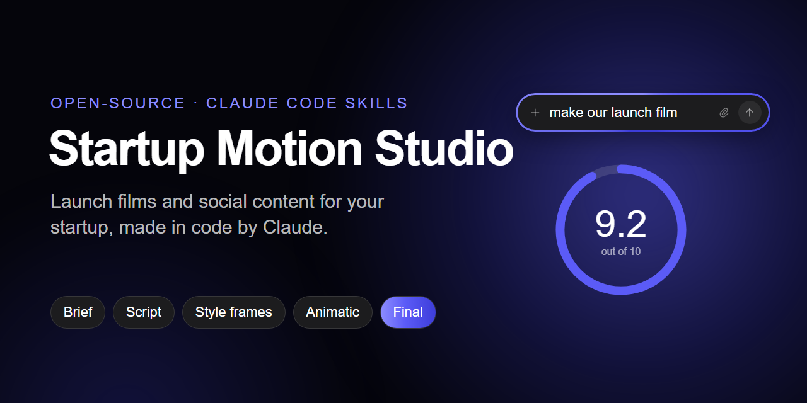
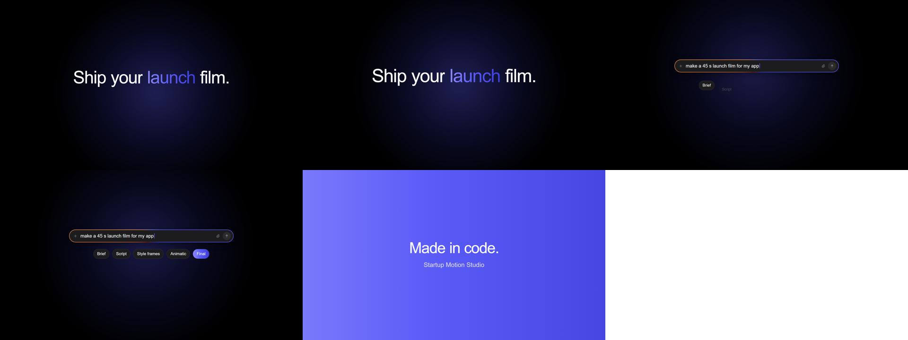

<p align="center"></p>

# Startup Motion Studio: open-source AI motion design for startup launch videos

**Make launch films, product demo videos and social media content for your startup with Claude Code. Apple / Linear-grade
motion design in code, with your real product and your brand.**

[](LICENSE)
[](.claude/skills)
[](docs/SETUP.md)
[](CONTRIBUTING.md)

[Setup guide](docs/SETUP.md) · [How it works](#how-it-works-the-gates) · [What you can make](#what-you-can-make) ·
[FAQ](#faq) · [Contributing](CONTRIBUTING.md)

Startup Motion Studio is a free, open-source **AI video production studio** made of Claude Code skills and a small
HTML/Python render engine. Claude acts as the whole studio: director, writer, designer, animator, sound and render engineer. It rebuilds your
product's screens in code, animates them with real spring physics, adds a voice-over and sound design, checks its own
frames, and stops at every creative decision for you to approve. No video AI, no templates, no subscription. Each
frame is a pure function of time, so the same code always renders the same film.


*`examples/hello-film`: a 6-second engine demo (open `hello-film.mp4`).*

## What you can make
| | |
|---|---|
| **Launch / feature films** (30–120 s, 16:9 + 9:16) | from a brief, or by remaking the rhythm and layout of a film you admire |
| **Social reels** (6–30 s) | one feature per reel: input → AI magic → output |
| **Carousels and static posts** | rendered from the same engine at 4:5 or 1:1 |
| **Captions, hooks, hashtags, a content calendar** | per platform: LinkedIn, Instagram, TikTok, X, YouTube Shorts |

## How it works: the gates
You approve each **[you]** step, and approved work is frozen.

1. **Brief [you]**: what, for whom, the one takeaway. Only questions that change the video.
2. **Script [you]**: one idea per beat, voice-over and on-screen words, timed to the music's beat grid.
3. **Style frames [you]**: 3–5 real stills of the film, with real words.
4. **Transitions [you]**: how each scene carries into the next.
5. **Animatic [you]**: the whole film timed, rough motion, temp audio.
6. **Build**: parallel agents animate shot groups; critic agents score every shot (fix until all ≥ 8/10); automated
   checks run (format, loudness, black/flash/frozen frames, phone-size readability).
7. **Final [you]**: MP4s per channel, a frame sheet, post copy.

Every note you give is answered with exactly what changed. Any mistake a check should have caught becomes a new
permanent check.

## Install (10 minutes)
Step-by-step guide with troubleshooting: [docs/SETUP.md](docs/SETUP.md).

You need [Claude Code](https://claude.com/claude-code) and Python 3.10–3.13.
```bash
git clone https://github.com/zarnabali/startup-motion-studio.git
cd startup-motion-studio
python tools/setup.py --voice
```
- The `--voice` flag adds local voice-over with Kokoro (about 340 MB).
- `--stems` is optional; it adds Demucs (about 1 GB).
- Nothing is installed system-wide. Everything lives in `tools/.venv`.

**Images (optional):**
- With the [Codex CLI](https://github.com/openai/codex) signed in, or `OPENAI_API_KEY` set, `make_image.py` generates assets.
- Without either, it writes the prompt to a file so you can use any image tool.

## Use it
Open the folder in Claude Code and say:
1. **"Set up my brand"**: runs the `studio-onboard` skill. It interviews you, reads your website, and fills the `brand/` kit (facts, voice, colours, fonts, logo).
2. **"Make a 45-second launch film for our app"**: runs the `motion-film` skill. Share your real app screenshots, and a reference video if you have one.
3. **"Plan a month of posts and make the first week"**: runs the `social-content` skill.

Your work goes in `projects/`, which git ignores, so it stays private.

## What's inside
```
.claude/skills/
  studio-onboard/   first-run: toolchain check + brand interview -> brand kit
  motion-film/      the film studio: gates, studio contract, technique catalogue, build + QA method
  social-content/   plans, reels, carousels, captions, hashtags, cut-downs
brand/              your brand kit (templates to fill): BRAND_BRAIN, tokens.json, fonts, logo, IMAGE_STYLE, LEARNINGS
tools/
  film-engine/      core.js (springs, camera, text, cursor), ui.js (UI kit), render.py, sfx.py, vo.py, new_film.py
  check_film.py     automated checks + frame / phone / contact sheets
  beats.py          beat grid of a music track
  make_image.py     image assets with your style lock (Codex CLI / OpenAI API / prompt-only)
  analyze_reference.py · stems.py · optimize_assets.py · new_job.py · setup.py
examples/hello-film a minimal film to learn the engine from
```

## Honest limits
- **Renders run on the CPU.** A 1080p frame takes about 1–1.5 s, so a 60 s film is about 30–45 minutes for the final render. Drafts are about 4× faster.
- **Claude writes every shot as code.** That's where the quality comes from. It also means:
  - films take a few sessions, not minutes;
  - big films use a lot of Claude usage, so use max effort for launches and medium for fixes.
- **Your product must be shown truthfully.** The studio won't invent features, numbers or customers.
- **Bring licensed music.** A reference film's song can only go under an internal review cut, never a delivered file.
- **Nothing is posted for you.** You stay in control of every account.

## FAQ

**Is this an AI video generator?**
Not in the "type a prompt, get a clip" sense. Claude writes the animation as code (HTML + springs), and a headless
browser renders it frame by frame into an MP4. That's why the motion is precise, on-brand and reproducible. No
generated video, so you get no melting hands and no fake UI.

**Do I need to know how to code or animate?**
No. You talk to Claude Code, approve the gates, and give notes. Knowing a little HTML helps if you want to tweak shots
yourself.

**What does it cost?**
The studio is free (MIT). You need a Claude plan for Claude Code. Images are optional: they're free with a signed-in
Codex CLI, paid with an OpenAI API key, or you can paste prompts into any image tool. Voice-over runs locally for free.

**Can it make vertical videos for TikTok, Instagram Reels and YouTube Shorts?**
Yes. Every film can be re-laid out at 9:16, 4:5 or 1:1 from the same timeline, never cropped. The `social-content`
skill writes the captions, hooks and hashtags for each platform.

**Can it copy the style of a video I like?**
Yes, in remake mode. It studies the reference frame by frame (cuts, beats, camera, transitions) and rebuilds the
grammar with your product and brand. It never reuses the reference's footage, logo or music.

**Does it post to my accounts?**
Never. It prepares files and post copy; you publish.

**Which platforms does it run on?**
Windows, macOS and Linux, with Python 3.10–3.13. A GPU isn't needed.

## Contributing
Bug reports, new motion techniques, `ui.js` components, platform updates, translations and showcase films are all
welcome. Read [CONTRIBUTING.md](CONTRIBUTING.md) and open an issue or a pull request. If this studio helped you ship a
launch video, a ⭐ helps other founders find it.

## Credits
- The engine is adapted from claude-motion-design by Howseen AI (MIT; licence text in `LICENSE`).
- The method draws on @0xMovez's public course "How to build a motion design studio with Opus 5.5".
- Voice: [Kokoro](https://github.com/thewh1teagle/kokoro-onnx) (Apache-2.0). Stems: Demucs (MIT).
- Studio built for and battle-tested on the Wearism launch film.

MIT licence (see `LICENSE`).
