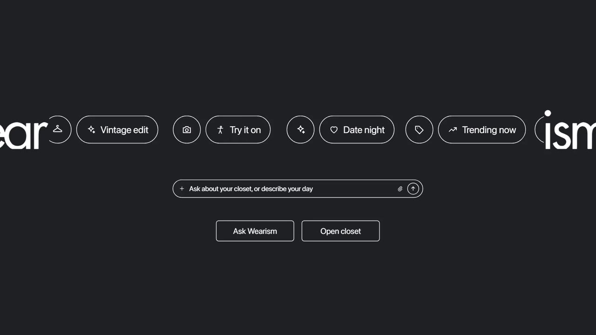

# Example: Wearism launch film (71 s, 16:9)

**[▶ Watch the film](wearism-launch-film.mp4)** · [thewearism.com](https://thewearism.com)

This is the film the studio was built and battle-tested on. Wearism is an AI wardrobe app for young women: tag what
you own, plan outfits, try them on, swap clothes with friends.

## How it was made
| Step | What happened |
|---|---|
| Reference | A Gemini-style startup launch film was deconstructed frame by frame: cuts, beat grid, camera moves, 28 techniques. |
| Remake | Same grammar, Wearism content: the wordmark split, chip stream, drop-flash montage, macro UI tilts, whips and the logo finale. |
| Real product | Every app screen was rebuilt in code from the founder's iPhone screenshots, so text types, answers stream and chips select live. |
| Real-looking photos | Wardrobe and street plates generated with the "real phone photo" lock; the founder rejected the glossy AI look on draft 1. |
| Sound | A local Kokoro voice-over timed to the beat, synthesized SFX and a licensed Pixabay bed ("Tech Ambient" by AleXZavesa), mixed to −14 LUFS. |
| Notes → checks | Each founder note became a permanent rule: no cropped images, no voice-over on self-explanatory text, the screen never goes blank. |

The film is © Wearism and is shown here as an example only. It isn't covered by this repo's MIT licence.
